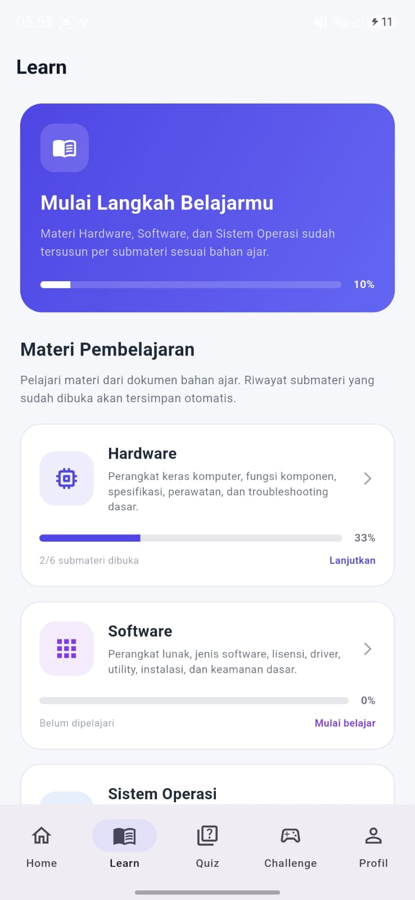
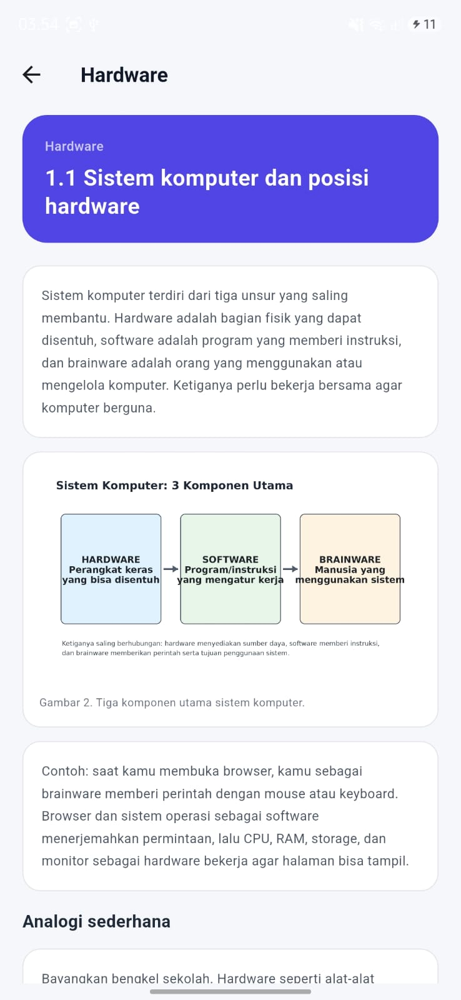
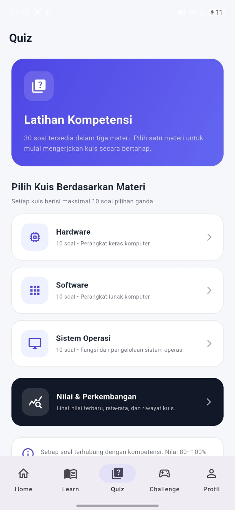
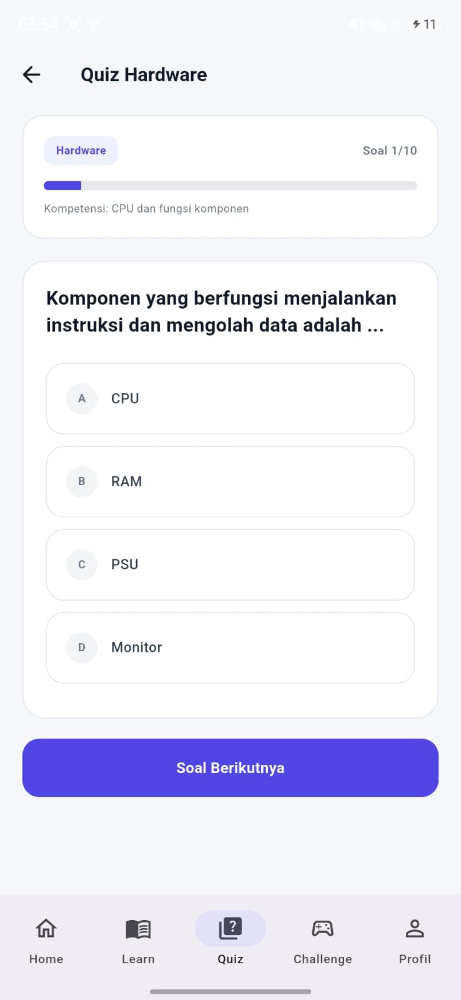
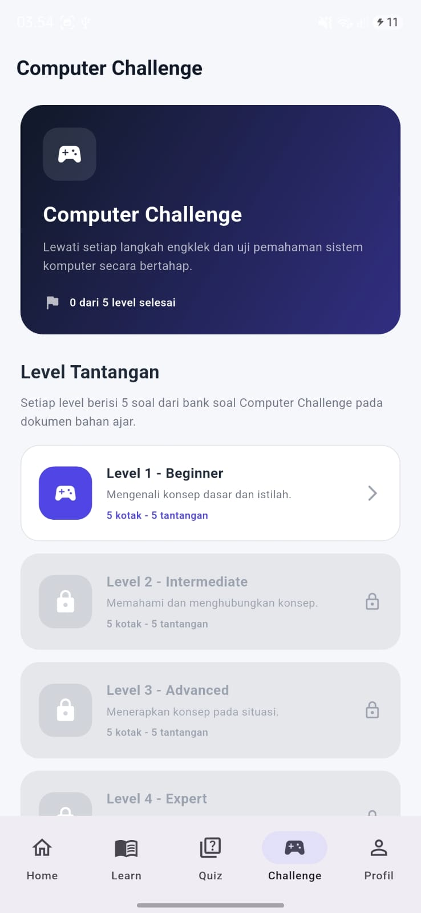

# TechStep — Edugame Sistem Komputer
TechStep adalah prototype aplikasi pembelajaran mobile berbasis Flutter untuk membantu siswa kelas X TJKT mempelajari materi Sistem Komputer secara mandiri. Materi utama mencakup **Hardware, Software, dan Sistem Operasi**. Pembelajaran menggabungkan materi digital, kuis, permainan edukatif, pemantauan progres, pemetaan penguasaan kompetensi, dan laporan hasil belajar.

> **Status:** prototype untuk UTS Mata Kuliah Mobile Programming. Pengujian lanjutan dan evaluasi pengalaman pengguna masih diperlukan.

## Fitur utama
- **Login dan Register** dengan validasi data akun.
- **Dashboard** untuk melihat ringkasan dan progres belajar.
- **Learn** untuk mempelajari Hardware, Software, dan Sistem Operasi melalui submateri.
- **Quiz per materi**; Hardware, Software, dan Sistem Operasi masing-masing memiliki 10 soal pilihan ganda.
- **Computer Challenge**, permainan dengan konsep engklek digital yang terdiri dari lima level tantangan.
- **Profile dan Nilai & Perkembangan** untuk menampilkan identitas, hasil evaluasi, riwayat pengerjaan, dan penguasaan kompetensi.
- **Learning Analytics** untuk mengolah aktivitas belajar dan hasil evaluasi menjadi informasi progres/penguasaan.
- **Learning Report** untuk menyajikan ringkasan hasil belajar dalam format PDF.
- **Logout** dan pemisahan progres berdasarkan akun yang sedang digunakan.

## Cuplikan antarmuka


### Dashboard
[Dashboard TechStep](assets/screenshots/dashboard.jpg)

### Materi pembelajaran



### Evaluasi dan permainan




## Teknologi
- Flutter dan Dart
- SQLite melalui package `sqflite` untuk penyimpanan lokal pada Android
- Penyimpanan persisten browser untuk versi Web
- Android SDK, Android Emulator, dan Android Debug Bridge (ADB) untuk pengujian Android

Laporan pengembangan mencatat lingkungan Flutter 3.47.2 stable, Dart 3.13.2, dan JDK 17.0.20.1 LTS. Konfigurasi lokal setiap pengembang dapat berbeda.

## Menjalankan proyek

### Prasyarat
1. Pasang Flutter SDK dan pastikan perintah `flutter --version` berjalan.
2. Siapkan Android SDK serta Android Emulator, atau gunakan perangkat Android yang terdeteksi oleh ADB.
3. Pasang Git untuk mengambil repository.

### Langkah
```bash
git clone https://github.com/Inesa27/TechStep.git
cd TechStep
flutter pub get
flutter devices
flutter run
```

Pastikan perintah `cd TechStep` berada pada direktori yang memuat `pubspec.yaml`. Jika ingin menjalankan versi Web dan target Chrome tersedia, gunakan:

```bash
flutter run -d chrome
```

Jika perangkat Android belum terdeteksi, periksa keluaran `flutter devices`, status emulator, serta `adb devices`. Untuk masalah dependency, jalankan kembali `flutter pub get` dan baca pesan error lengkap sebelum mengubah konfigurasi.

## Ringkasan arsitektur
Secara konseptual, aplikasi membagi tanggung jawab menjadi:
1. **Antarmuka (UI):** halaman Login/Register, Dashboard, Learn, Quiz, Computer Challenge, Profile, dan Learning Report.
2. **Logika aplikasi:** validasi input, navigasi, penilaian jawaban, dan pengelolaan alur belajar.
3. **Lapisan data:** penyimpanan akun dan data pembelajaran.
4. **Learning Analytics:** pengolahan progres, hasil quiz/challenge, serta pemetaan penguasaan kompetensi.
5. **Report Generator:** penyusunan ringkasan hasil belajar menjadi laporan PDF.

Nama file dan pembagian kode konkret mengikuti struktur sumber yang ada pada repository; uraian ini merupakan ringkasan fungsi tingkat sistem.

## Repository
Source code: <https://github.com/Inesa27/TechStep>

## Catatan pengembangan
Prioritas pengembangan berikutnya adalah memperluas pengujian pada perangkat dan ukuran layar yang berbeda, menguji persistensi hasil belajar setelah logout/login dan aplikasi dijalankan ulang, meninjau konsistensi perhitungan penguasaan kompetensi, serta mengevaluasi kemudahan penggunaan bersama calon pengguna.